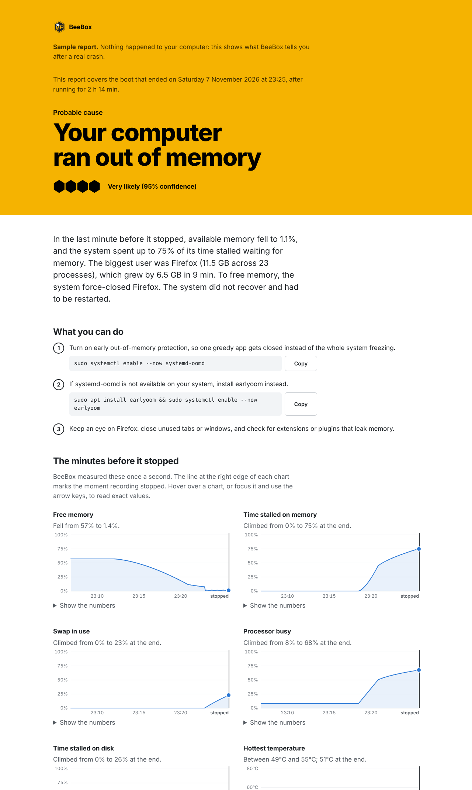
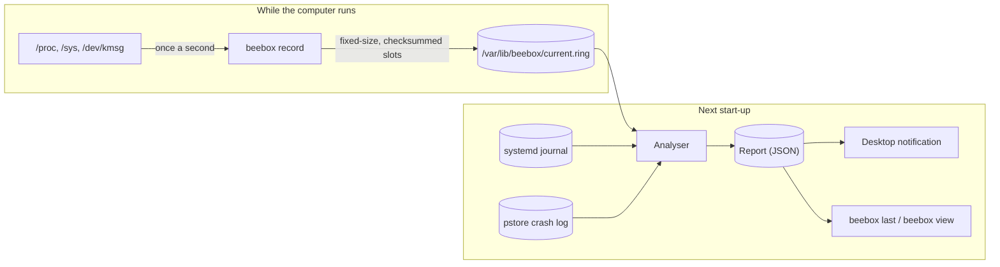

<p align="center">
  
</p>

<h1 align="center">BeeBox</h1>

<p align="center"><strong>A flight recorder for your Linux computer.</strong><br>
When it crashes, freezes or loses power, BeeBox tells you why — in plain language — and what to do about it.</p>

<p align="center">
  <a href="https://github.com/PurpleDefender249/beebox/actions/workflows/ci.yml"></a>
  <a href="https://github.com/PurpleDefender249/beebox/releases/latest"></a>
  <a href="LICENSE"></a>
</p>

<p align="center">
  
</p>

---

The screen froze. The mouse stopped. You held the power button. When the computer
came back, there was nothing to tell you what went wrong — and the system log from
that boot is either gone or full of noise.

BeeBox fixes that. It quietly records the last few minutes of your system's vital
signs into a crash-safe file. The next time the computer starts after something
went wrong, it works out what most likely happened and shows you:

```
$ beebox last
BeeBox report for the boot that ended Wed 4 Nov 2026, 23:11 (after 2 h 14 min)

  ● Very likely (95%)
  Your computer ran out of memory

  In the last minute before it stopped, available memory fell to 1.1%, and the
  system spent up to 75% of its time stalled waiting for memory. The biggest
  user was Firefox (11.7 GB across 23 processes), which grew by 6.7 GB in the
  last 10 min. The system did not recover and had to be restarted.

  What you can do
  1. Turn on early out-of-memory protection, so one greedy app gets closed
     instead of the whole system freezing.
     sudo systemctl enable --now systemd-oomd
  ...
```

If you're logged in to a desktop, a notification pops up with a button that opens
the full report in your browser.

<sub><strong>Why "BeeBox"?</strong> Like an aircraft's black box — a "B-box" — it keeps the last minutes before something goes wrong. Like a bee, it's small and always busy, and you'll rarely notice it until it matters.</sub>

## What it can tell you

| What happened | How BeeBox knows |
| --- | --- |
| **Ran out of memory** and froze | Pressure-stall info, free memory, swap, the kernel's OOM killer, systemd-oomd/earlyoom, and its own once-a-second check running late |
| **Kernel panic, lockup or bug** | Kernel crash logs saved to firmware (pstore), panic/oops/lockup messages, the faulting function and program |
| **Hardware error** | Machine-check (MCE) reports from the CPU |
| **Graphics driver hang** | amdgpu, i915, nouveau and NVIDIA (Xid, "fallen off the bus") reset and timeout messages |
| **Overheating** | Temperatures against each sensor's critical limit, throttling and thermal shutdown messages |
| **Battery ran flat** | Last battery readings and UPower's critical-battery action |
| **Never woke from sleep** | A suspend that never resumed, with the battery level when it went to sleep |
| **Disk errors, full disk, disk stalls** | NVMe/SATA/filesystem errors, free space, I/O pressure |
| **Power cut or hard reset** | A healthy system that simply stopped, with nothing in the logs (and, where the kernel can save crash logs, no crash log either) |
| **A test crash** | `SysRq + C` is recognised as deliberate, so testing BeeBox doesn't scare you |

When the evidence doesn't point anywhere, BeeBox says so instead of guessing.
See [docs/DETECTIONS.md](docs/DETECTIONS.md) for exactly how each verdict is reached.

## Install

**One command** — Debian, Ubuntu, Kali, Linux Mint, Fedora and Arch, on x86_64 or ARM64:

```sh
curl -fsSL https://purpledefender249.github.io/beebox/install.sh | sh
```

On Debian-family systems and Fedora this adds the signed BeeBox package repository,
so updates arrive with your normal system updates. On Arch it installs the latest
release after checking its signed checksums. The script prints every command before
running it; to read it first, download it and run `sh install.sh`.

Remove BeeBox the same way: `curl -fsSL https://purpledefender249.github.io/beebox/install.sh | sh -s -- --uninstall`

<details>
<summary><strong>Add the repository by hand</strong></summary>

Debian, Ubuntu, Kali, Linux Mint:

```sh
sudo install -d -m 0755 /etc/apt/keyrings
curl -fsSL https://purpledefender249.github.io/beebox/beebox.gpg | sudo tee /etc/apt/keyrings/beebox.gpg >/dev/null
curl -fsSL https://purpledefender249.github.io/beebox/beebox.sources | sudo tee /etc/apt/sources.list.d/beebox.sources >/dev/null
sudo apt update && sudo apt install beebox
```

Fedora:

```sh
sudo curl -fsSL -o /etc/yum.repos.d/beebox.repo https://purpledefender249.github.io/beebox/beebox.repo
sudo dnf install beebox
```

</details>

<details>
<summary><strong>Install a downloaded package</strong></summary>

Packages are on the [releases page](https://github.com/PurpleDefender249/beebox/releases/latest).

```sh
sudo apt install ./beebox_*_amd64.deb                     # Debian, Ubuntu, Kali, Mint
sudo dnf install ./beebox-*.x86_64.rpm                    # Fedora
sudo pacman -U ./beebox-*-x86_64.pkg.tar.zst              # Arch, Manjaro, EndeavourOS
sudo systemctl enable --now beebox                        # Arch only: start recording
```

</details>

<details>
<summary><strong>Build from source</strong> (needs Go 1.22 or newer)</summary>

```sh
git clone https://github.com/PurpleDefender249/beebox && cd beebox
make && sudo make install
sudo systemctl enable --now beebox
```

</details>

On Debian, Ubuntu, Kali, Mint and Fedora, BeeBox starts recording straight away.
Then check everything is in place:

```sh
beebox doctor
```

Something not working? See [docs/TROUBLESHOOTING.md](docs/TROUBLESHOOTING.md).

## Everyday use

| Command | What it does |
| --- | --- |
| `beebox status` | Is BeeBox recording? What does it see right now? |
| `beebox last` | The latest crash report |
| `beebox view` | Open the latest report in your browser (or the "BeeBox" app in your menu) |
| `beebox list` | Every report, newest first |
| `beebox now --watch` | Live view of memory, stalls, temperatures and battery |
| `beebox doctor` | Checks logs, memory protection, swap and crash logs, with the command to fix each |
| `sudo beebox analyze` | Analyse the previous boot on demand — also works for crashes from before BeeBox was installed |
| `beebox view --sample` | See what a report looks like without anything going wrong |

Every command has `--help`, and the ones that print data also have `--json` for scripts.
`man beebox` has the full reference.

## How it works



- The **recorder** samples once a second into a preallocated ring file. Every slot
  carries its own checksum, so a power cut mid-write loses at most one second. It
  locks itself into memory and runs with raised priority, so it keeps recording
  while the rest of the system thrashes.
- At the **next boot** it notices that the previous recording was never closed
  cleanly, archives it, and the **analyser** runs a set of rules over the recording,
  the previous boot's journal and any kernel crash log. Each rule scores its
  confidence; the strongest becomes the verdict.
- Clean shutdowns produce no report — except when the computer shut itself down
  to protect itself from heat or an empty battery.

More detail in [docs/ARCHITECTURE.md](docs/ARCHITECTURE.md).

## Light on your system

Measured on an idle desktop:

- **Memory:** about 11 MB.
- **CPU:** well under 1% of one core.
- **Disk:** a 1.8 MB recording (15 minutes) plus small JSON reports. It writes
  about 200 MB a day in total, less than a typical web browser.
- **Binary:** 5.5 MB, no libraries needed beyond the system's C loader.

## Privacy and security

- BeeBox records only what any user can already see in `/proc`: app names (never
  command-line arguments, file contents, window titles or anything you type),
  resource usage and kernel messages.
- The recorder runs with **networking disabled** by systemd and no access to home
  folders. Its systemd security exposure score is **1.4 ("OK")**.
- Report pages are self-contained, work offline and load nothing from the internet.
- Evidence lines have home folder names, IP addresses and MAC addresses removed, so
  a report is safe to attach to a bug report — but read it first.
- **Zero third-party Go dependencies.**

Full details: [docs/PRIVACY.md](docs/PRIVACY.md). Security policy: [SECURITY.md](SECURITY.md).

## Accessibility

- Terminal output never uses colour alone: every status has a symbol and a word.
  `--plain` (or `BEEBOX_PLAIN=1`) removes colour and sparklines for screen readers;
  `NO_COLOR` is respected.
- Report pages use semantic HTML, a skip link and visible keyboard focus. Every chart
  has a text summary, a screen-reader description, keyboard navigation (arrow keys)
  and a data table. Light and dark mode follow your system, and high-contrast modes
  (`forced-colors`) are supported.

## Configuration

Optional. Edit `/etc/beebox/beebox.conf`, then `sudo systemctl restart beebox`.

```ini
interval = 1s        # time between samples
window = 15m         # history kept in the recording
flush = 5s           # how often samples are forced to disk
top_processes = 5    # apps listed per sample
keep_reports = 50
keep_rings = 10
```

## Try it safely

`beebox view --sample` shows a sample report without anything going wrong.
To see BeeBox catch a real crash, use a virtual machine — [docs/TESTING-IN-A-VM.md](docs/TESTING-IN-A-VM.md)
walks through a power cut, a kernel panic and an out-of-memory freeze.

## FAQ

**Does it replace the system journal?** No. It complements it: the journal often
loses the last seconds before a crash, or isn't kept between boots at all. BeeBox keeps
its own copy of the measurements and the kernel's important messages.

**Will it slow my computer down?** No. See the numbers above.

**What about crashes before I installed it?** Run `sudo beebox analyze`. If your journal
kept the previous boot, BeeBox can still give a verdict from the logs.

**Does it work on servers?** Yes. Everything works without a desktop;
`beebox last --json` is handy for monitoring.

## Contributing

Bug reports, new detection rules and translations of advice for more distributions
are very welcome. See [CONTRIBUTING.md](CONTRIBUTING.md). Development needs only Go:

```sh
make check      # format, vet, tests with the race detector, staticcheck
```

## Licence

[MIT](LICENSE)
